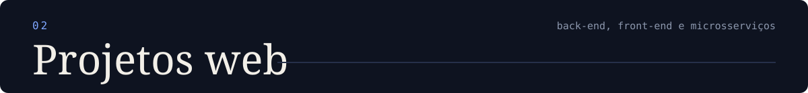
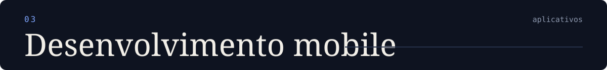

  

Estudo Engenharia de Computação na Universidade Federal do Ceará e trabalho com back-end em **Java/Spring** e
**TypeScript/NestJS**, front-end em **React** e automação em **Python**. Gosto de transformar trabalho repetitivo
em sistema que funciona sozinho. Estou estudando Cloud, com foco em AWS.

[Automações](#automações) · [Projetos web](#projetos-web) · [Desenvolvimento mobile](#desenvolvimento-mobile) · [Contato](#contato)

 

### SAM: o robô que transforma intimação em tarefa

  

Fluxo do SAM em motion. Todos os dados mostrados são fictícios. <a href="assets/sam-motion.mp4">Ver em MP4</a>.

Num escritório de advocacia, toda intimação (aviso da Justiça) precisa virar uma tarefa com prazo no sistema de
gestão. São dezenas por dia, e na segunda-feira chegam juntas as do fim de semana. O trabalho é repetitivo, exige
atenção, e um erro de data pode custar um prazo perdido. O SAM faz isso do começo ao fim, sem ninguém digitar.

| Etapa | O que acontece |
|---|---|
| Login | Entra sozinho no sistema do escritório |
| Captura | Pega só as intimações do dia anterior (na segunda, de sexta a domingo) que ainda não têm tarefa |
| Análise com IA | Uma IA lê cada intimação, segue o manual da Controladoria e decide o tipo do ato, a tarefa e o prazo em dias |
| Datas por regra | O código, não a IA, calcula as datas: só dias úteis, prazo fatal e tarefa dois dias antes, considerando feriados |
| Travas de segurança | Antes de gravar, barra o que está incompleto, duplicado ou com data vencida e encaminha para a equipe |
| Lançamento | Preenche o formulário da tarefa campo a campo, adiciona, confere o quadro e grava |
| Conferência | Abre o sistema de novo e confere se cada tarefa realmente ficou lá |
| Relatório | Entrega à equipe o que foi lançado, o que não foi e os pontos de atenção |

**Decisões de projeto**

- A IA entende o texto; as datas são calculadas por regra. Sem chute em prazo.
- Prefere não lançar a lançar errado: o que o robô barra vai para uma pessoa, nunca some.
- Confere o próprio trabalho: depois de gravar, verifica no sistema se a tarefa existe.
- Credenciais e seletores ficam em configuração, nunca no código.

`Python` `Selenium` `Flask` `Agentes de IA` `HTML/JS`

> O código do SAM é privado: ele roda em um escritório real e lida com dados de clientes.
> Aqui está só a explicação e o motion. Se quiser conversar sobre como foi feito, é só me chamar.

**Outras automações**

- **[Atlas Orquestrador](https://github.com/RuanPereiradev/atlas-orquestrador)**: orquestrador de eventos em NestJS para sincronização de dados em tempo real, com webhooks do Supabase. `NestJS` `TypeScript` `Supabase`
- **[CRM Sync Service](https://github.com/RuanPereiradev/crm-sync-service)**: serviço de sincronização de dados de CRM. `NestJS` `TypeScript`
- **[pyexcel](https://github.com/RuanPereiradev/pyexcel)**: script que lê uma base em Excel e separa os registros em abas por bairro, mantendo a formatação. `Python`

 

*Motion explicativo em produção.*

- **[Castel](https://github.com/RuanPereiradev/sistema-castelo)**: sistema de gestão hoteleira e de restaurante, em monolito modular com domínio rico. `Java 21` `Spring Boot` `React` `PostgreSQL` `Docker`
- **[CineSol](https://github.com/RuanPereiradev/cinesol-microsservice)**: plataforma de gestão de cinemas e venda de ingressos em arquitetura de microsserviços. `NestJS` `Kafka` `Prisma` `PostgreSQL` `Docker`
- **[Docket Auth API](https://github.com/RuanPereiradev/docket-backend)**: API de autenticação com MFA (TOTP). `Java 21` `Spring Boot` `PostgreSQL` `Redis`
- **[AgendaPro](https://github.com/RuanPereiradev/AgendaPro-FrontEnd)**: front-end de um sistema de agendamento profissional online. `Next.js` `React` `TypeScript` `Tailwind`
- **[LetterFy](https://github.com/RuanPereiradev/letterfy-frontend)**: plataforma para avaliar músicas e álbuns, com back-end em Java. `React` `Vite` `Tailwind`
- **[WmTur](https://github.com/RuanPereiradev/WmTur)**: landing page de vendas de passeios em Jericoacoara. `React` `Vite`

 

*Motion explicativo em produção.*

- **Glicare**: aplicativo para pacientes com diabetes, médicos e nutricionistas, com autenticação, controle de glicemia, gerenciamento de usuário, feedbacks, configurações e notificações. Atuei no back-end, incluindo o login com Google e iCloud. `C#` `.NET` `Docker`
  - [Backend do login com Google e iCloud](https://github.com/RuanPereiradev/Glicare-Login-Google-Icloud)
  - [Back-Glicare](https://github.com/RuanPereiradev/Back-Glicare)

 

  

 

- E-mail: [ruanpereira@alu.ufc.br](mailto:ruanpereira@alu.ufc.br)
- LinkedIn: [ruan-pereira-do-nascimento](https://www.linkedin.com/in/ruan-pereira-do-nascimento-ab6a45228/)
- Instagram: [@ruanpereira__](https://instagram.com/ruanpereira__)
