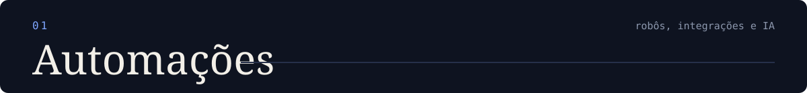
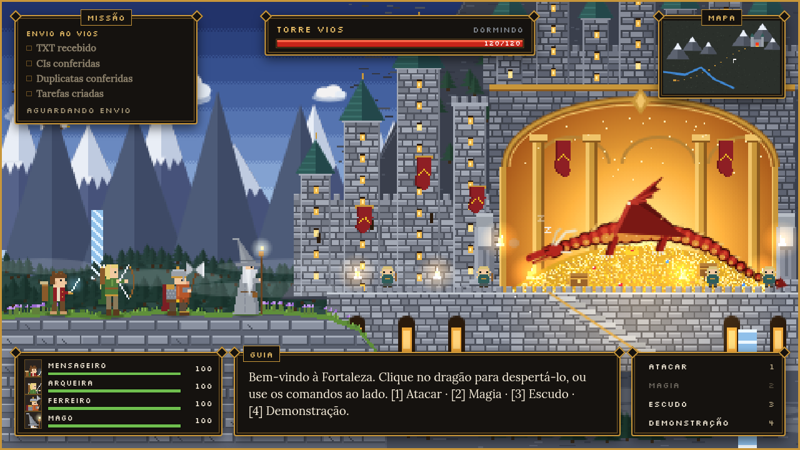
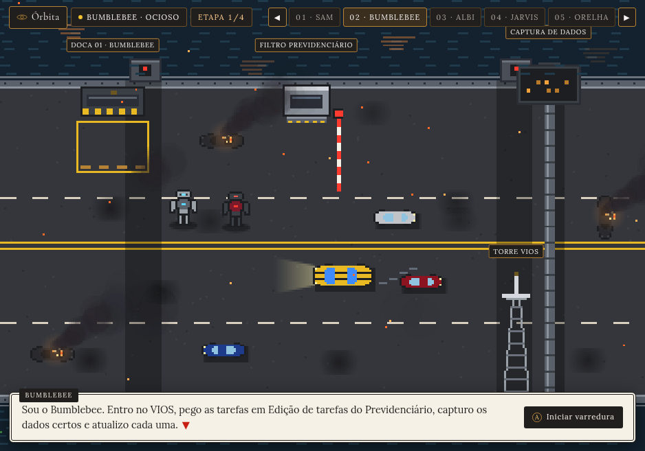
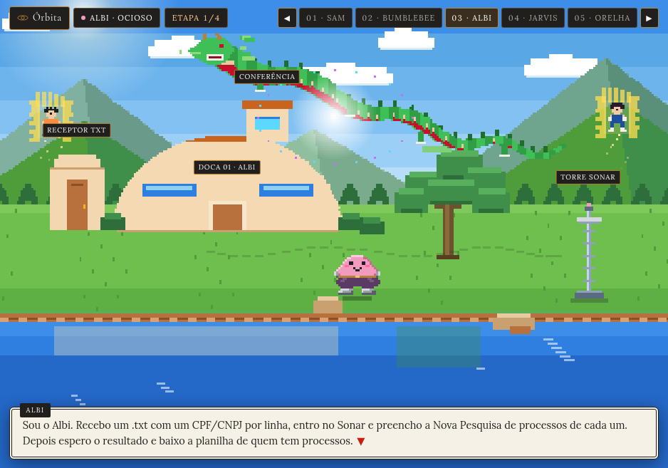
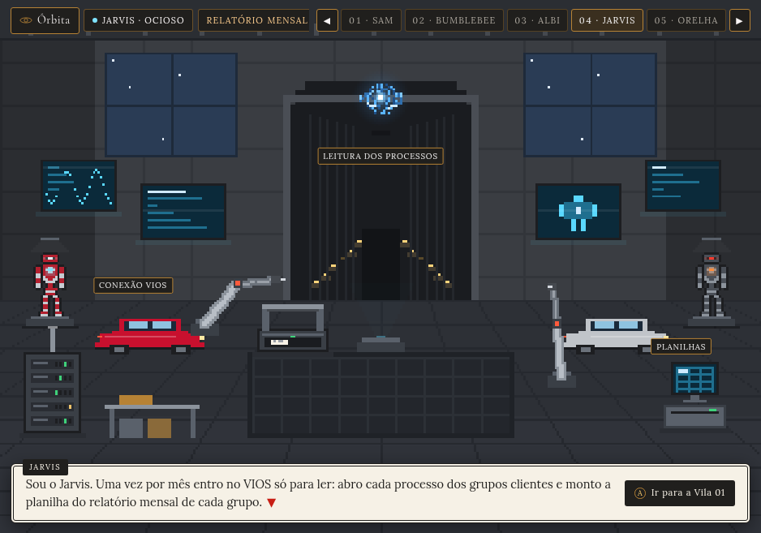
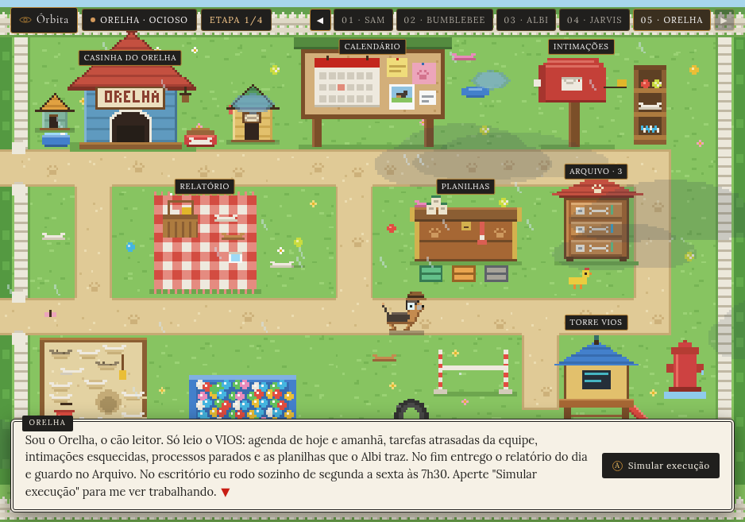
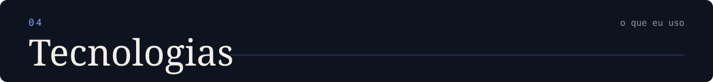

  

Estudo Engenharia de Computação na Universidade Federal do Ceará e trabalho com back-end em **Java/Spring** e
**TypeScript/NestJS**, front-end em **React** e automação em **Python**. Gosto de transformar trabalho repetitivo
em sistema que funciona sozinho. Estou estudando Cloud, com foco em AWS.

[Automações](#automações) · [Projetos web](#projetos-web) · [Desenvolvimento mobile](#desenvolvimento-mobile) · [Contato](#contato)

 

### SAM: o robô que transforma intimação em tarefa

  

Fluxo do SAM em motion. Todos os dados mostrados são fictícios. <a href="assets/sam-motion.mp4">Ver em MP4</a>.

Num escritório de advocacia, toda intimação (aviso da Justiça) precisa virar uma tarefa com prazo no sistema de
gestão. São dezenas por dia, e na segunda-feira chegam juntas as do fim de semana. O trabalho é repetitivo, exige
atenção, e um erro de data pode custar um prazo perdido. O SAM faz isso do começo ao fim, sem ninguém digitar.

| Etapa | O que acontece |
|---|---|
| Login | Entra sozinho no sistema do escritório |
| Captura | Pega só as intimações do dia anterior (na segunda, de sexta a domingo) que ainda não têm tarefa |
| Análise com IA | Uma IA lê cada intimação, segue o manual da Controladoria e decide o tipo do ato, a tarefa e o prazo em dias |
| Datas por regra | O código, não a IA, calcula as datas: só dias úteis, prazo fatal e tarefa dois dias antes, considerando feriados |
| Travas de segurança | Antes de gravar, barra o que está incompleto, duplicado ou com data vencida e encaminha para a equipe |
| Lançamento | Preenche o formulário da tarefa campo a campo, adiciona, confere o quadro e grava |
| Conferência | Abre o sistema de novo e confere se cada tarefa realmente ficou lá |
| Relatório | Entrega à equipe o que foi lançado, o que não foi e os pontos de atenção |

**Decisões de projeto**

- A IA entende o texto; as datas são calculadas por regra. Sem chute em prazo.
- Prefere não lançar a lançar errado: o que o robô barra vai para uma pessoa, nunca some.
- Confere o próprio trabalho: depois de gravar, verifica no sistema se a tarefa existe.
- Credenciais e seletores ficam em configuração, nunca no código.

`Python` `Selenium` `Flask` `Agentes de IA` `HTML/JS`

> O código do SAM é privado: ele roda em um escritório real e lida com dados de clientes.
> Aqui está só a explicação e o motion. Se quiser conversar sobre como foi feito, é só me chamar.

### Vila dos Bots: onde cada robô tem a sua vila

O SAM não trabalha sozinho. O escritório tem cinco robôs, e cada um mora numa vila em pixel art dentro da
**Vila dos Bots**, o painel que mostra o que cada um está fazendo. A vila só assiste: cada passo real do robô
vira um evento, e o mascote anda pela cena, explica na caixa de fala o que está fazendo e comemora (ou reclama)
no fim. Ela não grava nem aprova nada, e os eventos levam só fases e contagens, nunca nome de cliente nem o
teor de um processo.

As telas abaixo estão em modo simulação, sem dados reais. <a href="https://ruanpereiradev.github.io/autobots/">Abrir a vila em simulação</a>.

#### Vila 01 · Sam: a Fortaleza do Dragão

  

A vila do SAM é uma missão de RPG. A comitiva (Mensageiro, Arqueira, Ferreiro e Mago) acompanha o envio das
tarefas: o quadro **Missão** marca o arquivo recebido, as intimações conferidas, as duplicatas e as tarefas
criadas. Quando o lançamento começa, o dragão acorda, e a barra de vida da **Torre** cai a cada tarefa gravada.
Se uma tarefa dá erro, o dragão cospe fogo e a Torre diz o motivo. No fim, "Missão cumprida" com as contagens.

#### Vila 02 · Bumblebee: a batalha na ponte

  

O Bumblebee cuida dos comprovantes previdenciários: abre as tarefas que esperam edição, lê o protocolo e
preenche número do processo, órgão e valor em cada uma. A vila dele é uma ponte vista de cima. O filtro das
tarefas é uma cabine de pedágio com cancela, a captura de dados é o pórtico com o painel de mensagens, e a
antena da direita é a ligação com o sistema. Parado ele é um robô; para andar, as peças se encaixam e ele vira
um carro. Em volta, o trânsito segue e outros robôs duelam na pista.

#### Vila 03 · Albi: a arena

  

O Albi pesquisa processos em lote: recebe uma lista de CPFs e CNPJs por empresa, faz a pesquisa de cada um,
espera o resultado e baixa a planilha de quem tem processo. Na vila, ele sai da casa em domo, pega a lista no
anexo, confere as linhas na torre de observação e vai até a torre de pesquisa, uma linha por vez. O painel
mostra só o número da linha e o final do documento. No céu, dois lutadores se enfrentam, destroem a casa e
depois a reconstroem, num ciclo que nunca para.

#### Vila 04 · Jarvis: a garagem

  

Uma vez por mês, o Jarvis entra no sistema só para ler: abre cada processo dos grupos de clientes e monta a
planilha do relatório mensal de cada grupo. A vila é uma garagem com uma máquina para cada etapa: o rack com
antena (conexão com o sistema), o scanner de documentos (leitura dos processos) e o terminal com impressora
(planilhas). O Jarvis é o núcleo azul que voa de uma estação a outra, e a fala mostra o grupo, o processo
atual e o custo da leitura.

#### Vila 05 · Orelha: o parque

  

O Orelha é o cão leitor. De segunda a sexta, cedo, ele lê o sistema e entrega o relatório do dia: agenda de
hoje e amanhã, tarefas atrasadas, intimações esquecidas e processos parados. Cada parte tem um lugar no parque:
o mural do calendário, a caixa de correio das intimações, a toalha de piquenique onde sai o relatório e o
arquivo dos relatórios guardados. O parque reage aos números reais: cada tarefa atrasada é um ossinho enterrado
na caixa de areia, e quanto mais atrasos, mais nuvens no céu. Se a execução dá certo, ele sai correndo pelo
gramado; se dá erro, fica emburrado. Ao meio-dia ele come, e à noite dorme na frente da casinha.

`Pixel art em Canvas` `HTML/JS` `Flask` `Eventos em JSONL`

**Outras automações**

- **[Atlas Orquestrador](https://github.com/RuanPereiradev/atlas-orquestrador)**: orquestrador de eventos em NestJS para sincronização de dados em tempo real, com webhooks do Supabase. `NestJS` `TypeScript` `Supabase`
- **[CRM Sync Service](https://github.com/RuanPereiradev/crm-sync-service)**: serviço de sincronização de dados de CRM. `NestJS` `TypeScript`
- **[pyexcel](https://github.com/RuanPereiradev/pyexcel)**: script que lê uma base em Excel e separa os registros em abas por bairro, mantendo a formatação. `Python`

 

*Motion explicativo em produção.*

- **[Castel](https://github.com/RuanPereiradev/sistema-castelo)**: sistema de gestão hoteleira e de restaurante, em monolito modular com domínio rico. `Java 21` `Spring Boot` `React` `PostgreSQL` `Docker`
- **[CineSol](https://github.com/RuanPereiradev/cinesol-microsservice)**: plataforma de gestão de cinemas e venda de ingressos em arquitetura de microsserviços. `NestJS` `Kafka` `Prisma` `PostgreSQL` `Docker`
- **[Docket Auth API](https://github.com/RuanPereiradev/docket-backend)**: API de autenticação com MFA (TOTP). `Java 21` `Spring Boot` `PostgreSQL` `Redis`
- **[AgendaPro](https://github.com/RuanPereiradev/AgendaPro-FrontEnd)**: front-end de um sistema de agendamento profissional online. `Next.js` `React` `TypeScript` `Tailwind`
- **[LetterFy](https://github.com/RuanPereiradev/letterfy-frontend)**: plataforma para avaliar músicas e álbuns, com back-end em Java. `React` `Vite` `Tailwind`
- **[WmTur](https://github.com/RuanPereiradev/WmTur)**: landing page de vendas de passeios em Jericoacoara. `React` `Vite`

 

*Motion explicativo em produção.*

- **Glicare**: aplicativo para pacientes com diabetes, médicos e nutricionistas, com autenticação, controle de glicemia, gerenciamento de usuário, feedbacks, configurações e notificações. Atuei no back-end, incluindo o login com Google e iCloud. `C#` `.NET` `Docker`
  - [Backend do login com Google e iCloud](https://github.com/RuanPereiradev/Glicare-Login-Google-Icloud)
  - [Back-Glicare](https://github.com/RuanPereiradev/Back-Glicare)

 

  

 

- E-mail: [ruanpereira@alu.ufc.br](mailto:ruanpereira@alu.ufc.br)
- LinkedIn: [ruan-pereira-do-nascimento](https://www.linkedin.com/in/ruan-pereira-do-nascimento-ab6a45228/)
- Instagram: [@ruanpereira__](https://instagram.com/ruanpereira__)
